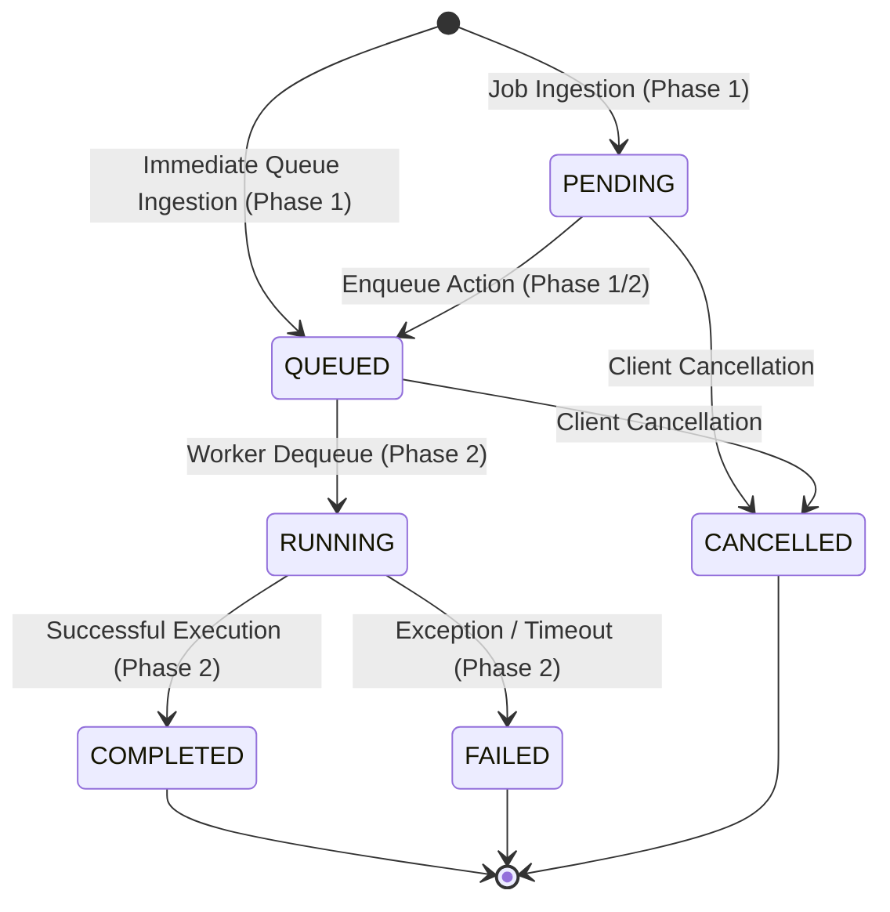

# FlowOps — Job Lifecycle & State Machine Specification

## 1. Lifecycle State Machine

FlowOps defines an explicit, deterministic state machine governing job execution:

---

## 2. Status Definitions

1. **`PENDING`:**
   - The job has been ingested, validated, and safely stored in PostgreSQL.
   - It is awaiting dispatch or schedule evaluation.
2. **`QUEUED`:**
   - The job is ready in the queue pipeline for worker consumption.
3. **`RUNNING`:**
   - A worker process has claimed the job (`started_at` timestamp recorded).
4. **`COMPLETED` (Terminal):**
   - The task finished successfully with output data populated in `result`.
5. **`FAILED` (Terminal):**
   - The task encountered an unhandled error or exhausted retry attempts; `error_message` is populated.
6. **`CANCELLED` (Terminal):**
   - The job was cancelled before execution commenced.

---

## 3. State Transition Validation Rules

Managed inside `apps.jobs.services.JobLifecycleService`:

| From State | Allowed Target States | Disallowed / Illegal Transitions |
|---|---|---|
| `PENDING` | `QUEUED`, `CANCELLED` | `RUNNING`, `COMPLETED`, `FAILED` |
| `QUEUED` | `RUNNING`, `CANCELLED` | `PENDING`, `COMPLETED`, `FAILED` |
| `RUNNING` | `COMPLETED`, `FAILED` | `PENDING`, `QUEUED`, `CANCELLED` |
| `COMPLETED` | *(None - Terminal)* | Any |
| `FAILED` | *(None - Terminal)* | Any |
| `CANCELLED` | *(None - Terminal)* | Any |

### Safeguards in Phase 1
- **No Arbitrary Modification:** The API endpoints reject `PATCH` and `PUT` on individual jobs. Clients cannot forge execution status.
- **Atomic Locking:** State transitions execute using PostgreSQL `SELECT FOR UPDATE` inside `transaction.atomic()` to prevent race conditions during high-concurrency worker polling.

